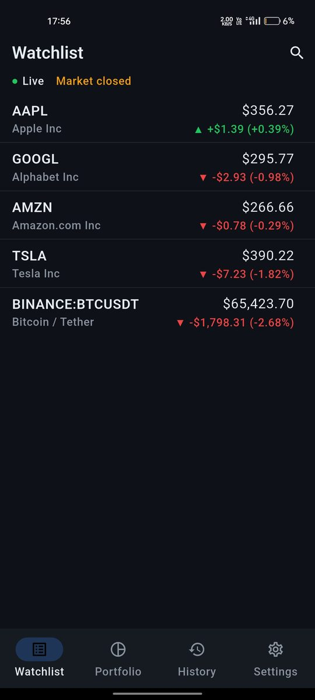
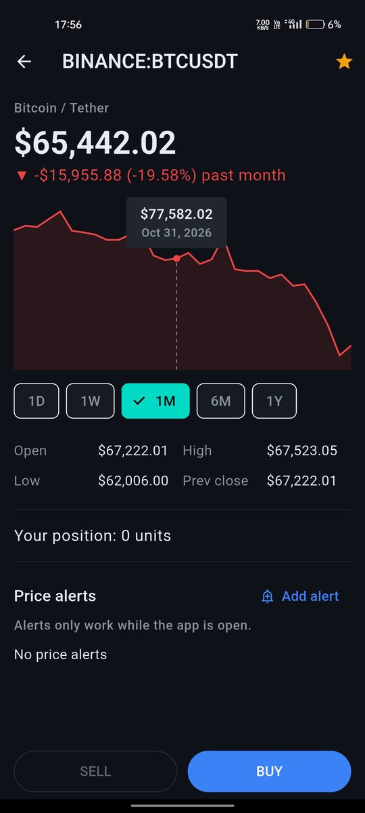
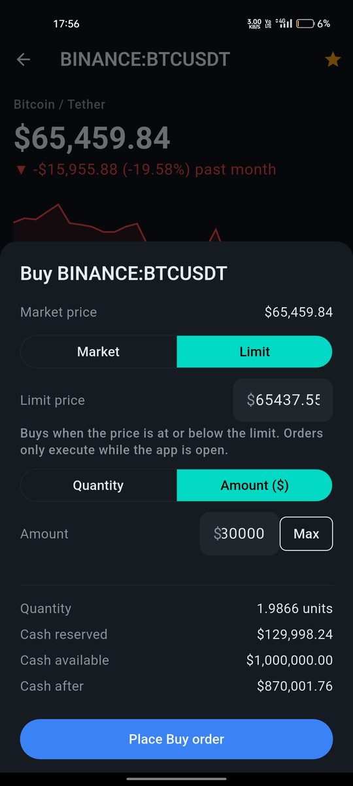
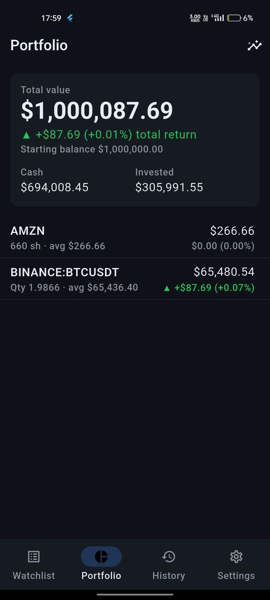
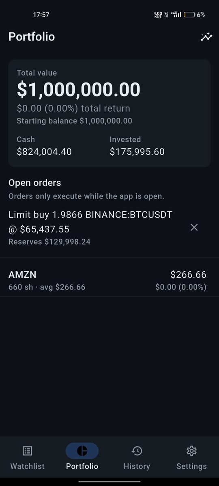
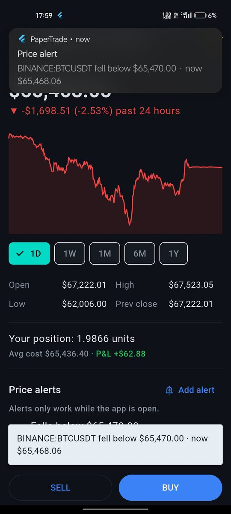
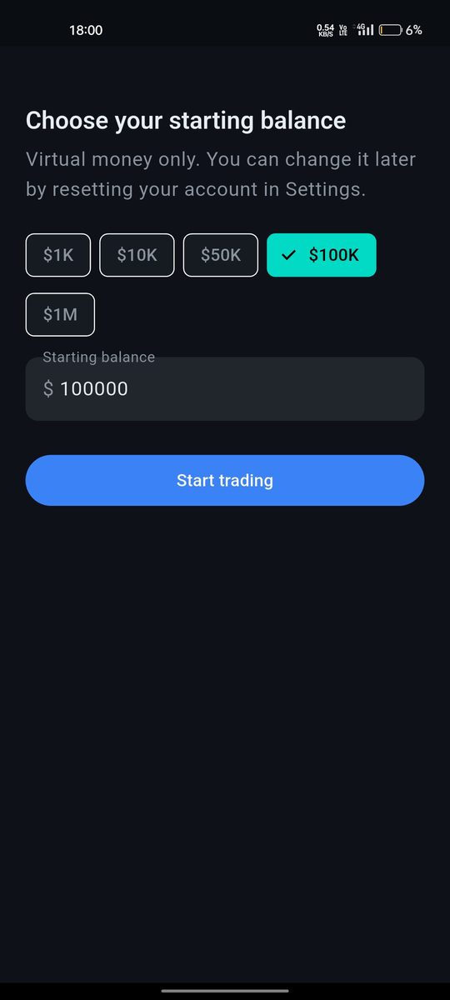

# PaperTrade

**A Flutter stock-trading simulator: real, live market prices — virtual money.**

Practice buying and selling US stocks and crypto with a virtual wallet (you choose the starting balance), place market, limit and stop-loss orders, and watch your profit and loss move in real time.

📲 **[Download the Android APK](https://github.com/VanditKenia/PaperTrade/releases/latest)** (Android 6.0+, sideloaded).

> ⚠️ **Virtual money only.** PaperTrade has no real money, no broker connection and no payments. Every trade is simulated on your device. Market data is provided by Finnhub and may be delayed.

---

## Features

**Market data**
- **Live prices** streamed over WebSocket, with a green/red flash on every tick
- **Search** any US-listed stock by name or symbol, and add it to your **watchlist**
- **Multi-timeframe charts**: 1D · 1W · 1M · 6M · 1Y, with a touch crosshair showing price and date; 1D keeps extending with live ticks
- **Market status** chip (open/closed); crypto (`BINANCE:BTCUSDT`) trades 24/7

**Trading**
- **Choose your starting balance** ($1K to $1M presets, or any amount) and change it later with **Reset account**
- **Market, limit and stop-loss orders**; pending orders reserve cash or quantity so nothing is double-spent
- **Fractional quantities** (up to 4 decimals) and an **Amount ($)** mode that converts dollars to quantity
- Order sheet with Max button, live cost and cash-after preview, and inline validation

**Tracking**
- **Portfolio** with holdings, average cost, live unrealized P&L, total value and total return vs. your starting balance
- **Open orders** list with cancel
- **Performance stats**: realized P&L, win rate, average win/loss, best and worst trade, and portfolio value over time
- **Price alerts** ("rises above" / "falls below") with in-app banners and Android notifications
- **Trade history** showing how each trade was filled, with realized P&L on every sell

**Reliability**
- **Offline persistence**: watchlist, balance, holdings, orders, alerts and trades survive app restarts
- **Resilient connection**: offline banner, "Reconnecting…" indicator and automatic reconnect
- **No API keys in the app**: all market data goes through a Cloudflare Worker proxy

## Screenshots

| Watchlist | Stock detail (1M chart) | Limit order | Portfolio |
|---|---|---|---|
|  |  |  |  |

| Open orders | Price alert | Starting balance |
|---|---|---|
|  |  |  |

## Architecture

Layered, feature-first architecture (MVVM with Riverpod). Dependencies point inward only.

```
UI (screens / widgets)
   │ watches
   ▼
Providers (Riverpod Notifiers — state + view logic, the "ViewModels")
   │ calls
   ▼
Repositories (single source of truth; combine API + cache + storage)
   │ uses
   ▼
Data sources (proxy REST client, proxy WebSocket relay, Hive local store)

Domain (models + PortfolioEngine) — pure Dart, used by all layers, depends on nothing
```

**Live price flow**

```
Finnhub WebSocket ─▶ proxy relay ──trade msgs──▶ PriceStreamService
                                     │ parse defensively, keep latest price per symbol
                                     ▼
                               throttle (500 ms)
                                     │ emit one snapshot
                                     ▼
                           livePricesProvider
                           │                │
                           ▼                ▼
                 Watchlist rows       Portfolio / Stock detail
             (only changed rows        (P&L recomputed from
                  rebuild)               PortfolioEngine)
```

```
lib/
  core/       config, money formatting, theme, throttle
  domain/     models + portfolio_engine.dart (pure Dart)
  data/       finnhub_api, price_stream_service, local_store, repositories
  features/   watchlist, search, stock_detail, portfolio, history, alerts, settings
proxy/        Cloudflare Worker (TypeScript): API keys, REST routes, WebSocket relay
```

**API key proxy.** The app holds no API key. It calls our Cloudflare Worker (`proxy/`, free plan), which adds the Finnhub / Twelve Data keys server-side, forwards only the four REST calls the app uses (`/quote`, `/search`, `/market-status`, `/history`) with validated params, caches them at the edge, rate-limits per IP, and relays live trades through **one** shared upstream WebSocket held by a Durable Object.

## Tech stack

| Concern | Choice |
|---|---|
| Framework | Flutter 3.50 · Dart 3.14 |
| State management | flutter_riverpod (Notifier / AsyncNotifier) |
| Local storage | Hive CE (IndexedDB on web, files on Android) |
| Real-time data | web_socket_channel → proxy relay → Finnhub WebSocket |
| REST | http → our proxy → Finnhub REST (search, quotes, market status) and Twelve Data (history) |
| Backend | Cloudflare Workers + Durable Objects (TypeScript, Wrangler, Vitest) |
| Charts | fl_chart |
| UI | material_ui, intl |
| Testing | flutter_test, mocktail, fake_async |

## Key engineering decisions

- **Money is integer cents.** Every balance, cost and P&L is an `int` number of cents. Floating point can't represent money exactly (`0.1 + 0.2 != 0.3`), so prices from the API are converted once with `(price * 100).round()`.
- **Throttled live updates.** Busy symbols can send dozens of trades per second. Ticks are buffered (latest price per symbol wins) and pushed to the UI at most every 500 ms, and each row watches only its own symbol with `select()`, so one price change rebuilds one row.
- **Immutable portfolio engine.** `PortfolioEngine` is pure Dart: it takes a state and returns a new state, or throws a typed error (`InsufficientFunds`, `InsufficientShares`, `InvalidQuantity`, `PriceUnavailable`). A trade can never be half-applied, and the engine is tested without Flutter.
- **Atomic saves.** The whole portfolio (cash, holdings, pending orders, trades) is written to Hive as one value after the engine succeeds, so a crash can't leave cash deducted without the holding added.
- **Order matching outside the portfolio.** Limit and stop orders are checked by a separate `orderMatcherProvider` that watches live prices and calls the portfolio with the triggering price; matching rules and cash/quantity reservations are pure Dart and unit-tested.
- **Fractional quantities stay exact.** Quantities are integers in units of 1/10,000; cost is `qtyUnits × priceCents / 10,000`, rounded half-up in one tested helper.
- **No provider dependency cycles.** Price providers never depend on the portfolio, and the portfolio never reads prices; the fill price is passed in from the order sheet. Anything that needs both (portfolio summary, WebSocket subscriptions) lives in its own provider.
- **Resilient WebSocket.** Auto-reconnect with exponential backoff (1 s → 30 s), re-subscribing every symbol after a reconnect. Malformed messages are skipped, never crash the stream.
- **No API key in the app.** Keys are Cloudflare Worker secrets; the app only gets `PROXY_BASE_URL` at build time, so nothing can be pulled out of the APK or the browser's Network tab. The Worker validates every parameter, allows only the routes the app uses, caches responses (quote 15 s … history 1 h), rate-limits per IP and limits CORS to localhost and our web origin.
- **One upstream WebSocket for everyone.** Free Finnhub keys allow very few socket connections, so a single Durable Object holds one upstream socket, subscribes it to the union of all clients' symbols, unsubscribes when nobody needs one, and sends each client only its own trades.

## Getting started

**1. Get free API keys** at [finnhub.io](https://finnhub.io) and [twelvedata.com](https://twelvedata.com) (history is optional).

**2. Deploy the proxy** (Cloudflare free plan; details and checks in [proxy/README.md](proxy/README.md)):

```bash
cd proxy
npm install
npx wrangler login
npx wrangler secret put FINNHUB_API_KEY
npx wrangler secret put TWELVE_DATA_API_KEY
npx wrangler deploy        # prints https://papertrade-proxy.<subdomain>.workers.dev
cd ..
```

**3. Point the app at it** (gitignored config file):

```bash
cp env.example.json env.json        # Windows: copy env.example.json env.json
```

```json
{ "PROXY_BASE_URL": "https://papertrade-proxy.<subdomain>.workers.dev" }
```

For example, this project's deployed proxy is `https://papertrade-proxy.vanditkenia.workers.dev`. Use your own deployment when you fork it: the proxy's rate limit and quotas are shared by everyone who calls it.

**4. Run the app:**

```bash
flutter pub get
flutter run -d chrome --dart-define-from-file=env.json     # web
flutter run --dart-define-from-file=env.json               # Android device / emulator
```

US markets trade roughly 8:00 PM–2:30 AM IST on weekdays. Outside those hours, stock prices stay at the last close; use `BINANCE:BTCUSDT` to see live ticks.

## Tests

```bash
flutter test       # 287 tests
flutter analyze    # no issues
cd proxy && npm test   # 44 Worker tests (Vitest)
```

Covered: the portfolio engine (buy/sell, weighted average cost, realized and unrealized P&L, a full worked example), fractional rounding, limit/stop matching and reservations, performance metrics, price-alert triggers, custom starting balance and data migration, history parsing and caching, money formatting, the throttle, WebSocket parsing and reconnect, Hive persistence across a simulated restart, providers (including a no-dependency-cycle test), and widget tests for the order sheet, onboarding, alerts, portfolio and app shell. The Worker's validation, routing, rate limiting and subscription logic are tested with Vitest. Tests never touch the real network or socket.

## Future scope

- **Server-side order matching and alerts**, so limit/stop orders and alerts fire 24/7, not only while the app is open
- Accounts and cloud sync (Supabase Auth + Postgres with row-level security)
- Candlestick view and technical indicators (SMA, EMA, RSI)
- Indian markets (NSE/BSE), e.g. through NSE's official MCP server behind the backend
- Native iOS build and release on a Mac
- App attestation so only the real app can call the proxy; exact (non per-isolate) rate limiting

## Docs

Product and technical specs live in [`docs/`](docs/): PRD, TRD, architecture, app flow, UI/UX, API spec, security, testing, roadmap and progress log.

---

Built by [Vandit Kenia](https://github.com/VanditKenia) with Claude Code as an AI coding assistant.
